<p align="center">
  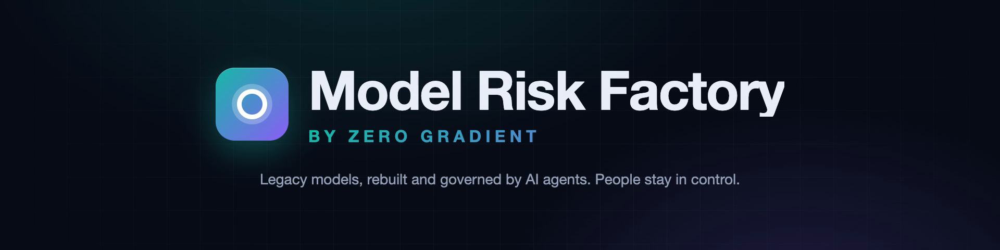
</p>

<p align="center">
  <b>An agentic model-risk platform for any legacy R model.</b><br>
  Agents discover, document, rebuild, validate and monitor your models, and a person approves every step.
</p>

<p align="center">
  
  
  
  
</p>

<p align="center">
  
  
  
  
  
  
</p>

<p align="center">
  <a href="#-see-it-in-3-minutes">Demo</a> ·
  <a href="#-why-it-matters">Why</a> ·
  <a href="#-whats-new">What's new</a> ·
  <a href="#%EF%B8%8F-a-tour-of-the-product">Tour</a> ·
  <a href="#%EF%B8%8F-how-a-model-flows">How it works</a> ·
  <a href="#-run-it">Run it</a>
</p>

---

<a id="#-see-it-in-3-minutes"></a>
## 🎬 See it in 3 minutes

<p align="center">
  <a href="https://www.youtube.com/watch?v=uY42OlJuPKs" title="Watch the demo on YouTube">
    
  </a>
</p>

<!-- INLINE PLAYER: on github.com, edit this README, drag docs/demo/model-risk-factory-demo.mp4 into the editor,
     and paste the generated https://github.com/user-attachments/assets/… link on its own line here. -->

## 💡 Why it matters

Banks run hundreds of models written in R by people who have moved on. Supervisors (**SR 11-7**, **PRA SS1/23**) expect
every one of them to be inventoried, documented, validated, monitored and traceable. Today that means **weeks of manual
re-work per model**: re-running scripts, re-deriving numbers, re-writing documentation.

Model Risk Factory turns that into a governed production line. Upload the script and its data. Agents work out what the
model is, document it, rebuild it in Python with **proven parity**, validate it against a plan they designed for *that*
model, and monitor it live. **People approve every step.** Nothing about any model is hard-coded: specifications,
contracts, validation plans, monitoring plans, prompts and policy rules are versioned records you can edit.

### What the challenge asked for, and where it lives

| Requirement | How it is met |
|---|---|
| Document 3-5 sample models | Five legacy R models onboarded through the normal upload path (see *Test estate*); SR 11-7 documentation generated for each |
| Rebuild a model in Python with parity proof | R → Python translation certified on every row (scores, coefficients, decisions within 1e-6, plus single-request scoring) |
| Validation report on performance, stability and fairness | Plan-driven validation with fairness checks in every run; every figure in the report is reproducible |
| Monitoring | Agent-designed KPIs, alert rules and drift scenarios, with a live dashboard |

### Measured in the recorded run

| ⏱️ Legacy R → certified Python | 🏭 Models in the run | 💸 LLM cost, whole run | 🧾 Agent steps on the ledger |
|:---:|:---:|:---:|:---:|
| **15 min** for CR-001, reviews included | **5** | **$0.03** | **445** |

<sub>From the recorded demo run (`gpt-4o-mini`). Your timings depend on the model, the hardware and how fast reviewers decide.</sub>

### Cost of one complete lifecycle, per model

| Path | Example | LLM calls | Agent steps | LLM cost |
|---|---|---:|---:|---:|
| **Translate** · discover → document → R→Python parity → validate → deploy → drift alert → re-validation | CR-001 | 68 | 195 | $0.017 |
| **Rehost** · discover → document → validate in R → closed (not deployed) | CR-002 | 27 | 68 | $0.002 |
| **Average per model** | | **≈ 48** | **≈ 132** | **≈ $0.01** |

**Five models, full lifecycle (projected from the average):** ≈ 240 LLM calls, ≈ 660 agent steps, ≈ $0.05. That ranges
from ≈ $0.01 if all five are rehosted to ≈ $0.08 if all five are translated and go through a drift re-validation.

<sub>Measured on the two models that completed a full lifecycle in the recorded run; the 5-model figure multiplies the
average, so it's an estimate. Step counts include every plan, thought, tool call, result and decision.</sub>

### Capacity

- **No limit on how many models are in the factory.** Any number can be onboarded and in progress; a model waiting at a
  human gate holds no compute.
- **4 agent stages run at the same time** (`ThreadPoolExecutor(max_workers=4)` in `backend/app/orchestrator/pipeline.py`).
  A fifth model shows *queued: waiting for a free agent worker* until one frees up.
- **Each R sandbox gets up to 2 CPUs / 2 GB**, so 4 concurrent stages need about 8 CPUs / 8 GB. That fits a 10-core,
  16 GB laptop; raise the worker count on a larger machine.

## ✨ What's new

| | |
|---|---|
| 🧠 **Evidence-bound agents** | Every agent plans, thinks, calls real tools and checks results. It cannot finish until its mandatory tools *succeed*; step budgets and hard blockers force a **HOLD**. |
| ✅ **Proven translation** | Legacy R → Python, certified row by row: every score, coefficient and decision within 1e-6, plus single-request scoring. Models that can't be reproduced exactly are **rehosted**, never faked. |
| 🔢 **Numbers you can audit** | The LLM never writes a figure. Every number in a report is a token linked to code, data and a one-click **Reproduce**. |
| 📈 **Agent-designed monitoring** | KPIs, thresholds, alert rules, dashboard panels and drift scenarios chosen per model, editable by people. A red alert triggers diagnosis and re-validation. |
| 🧑‍⚖️ **Human in the loop** | A gate at every stage, decided from the floor or the approvals queue: approve, send back with instructions, or reject. Every decision goes on a **hash-chained ledger**. |
| 🛡️ **Responsible AI, built in** | Fairness checks in every validation, SS1/23 controls scored from evidence, a prompt-injection self-test, sandboxed execution of untrusted code. |

## 🖼️ A tour of the product

<table>
  <tr>
    <td width="50%" valign="top">
      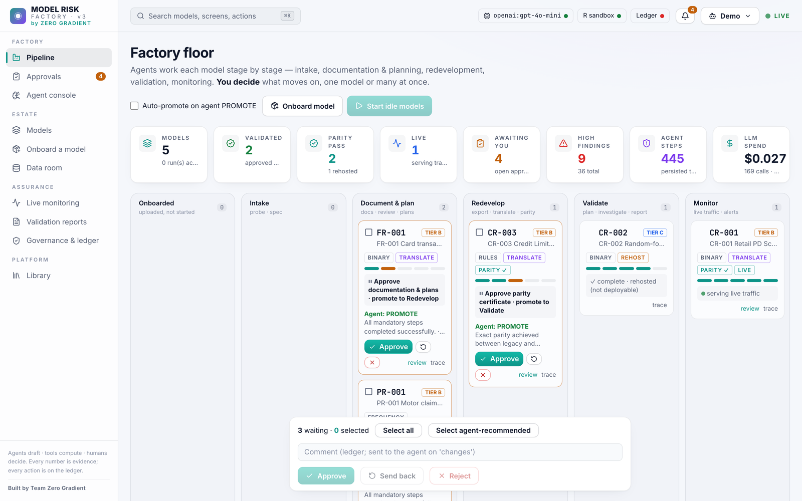<br>
      <b>Factory floor.</b> Every model, every stage, live. Start the whole estate in one click and approve gates straight from the cards.
    </td>
    <td width="50%" valign="top">
      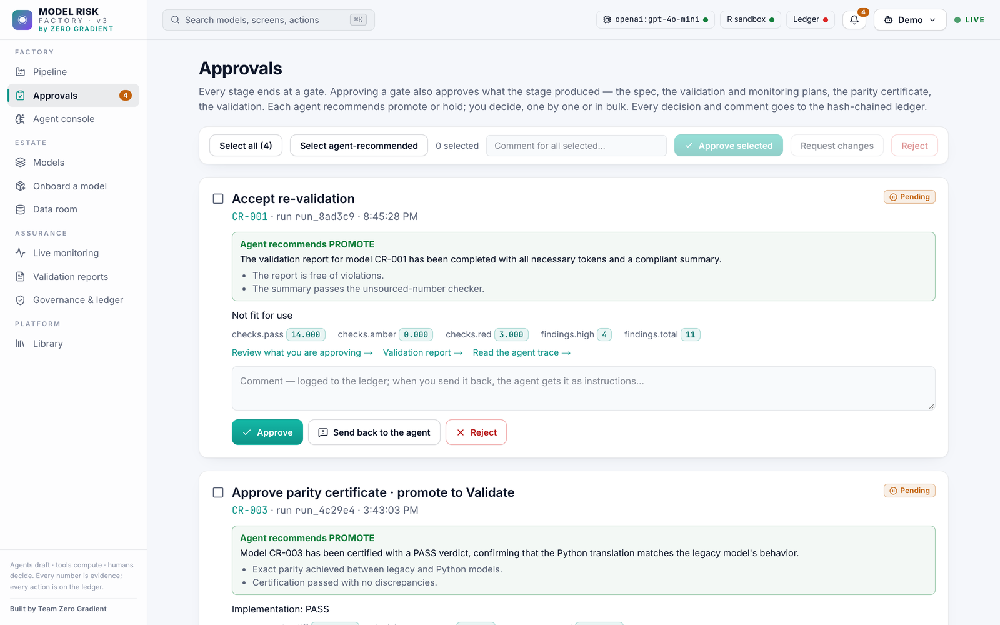<br>
      <b>Approvals.</b> What is being approved, the agent's recommendation and its evidence. Decide one by one or in bulk.
    </td>
  </tr>
  <tr>
    <td valign="top">
      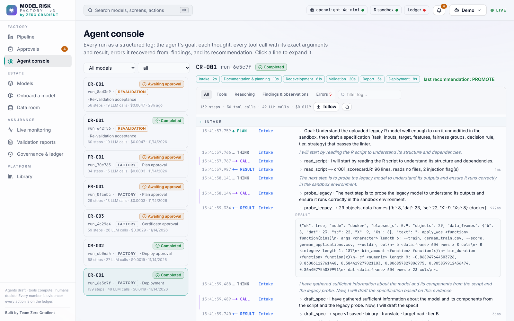<br>
      <b>Agent console.</b> Every plan, thought, tool call (with arguments), result and decision, streamed and filterable.
    </td>
    <td valign="top">
      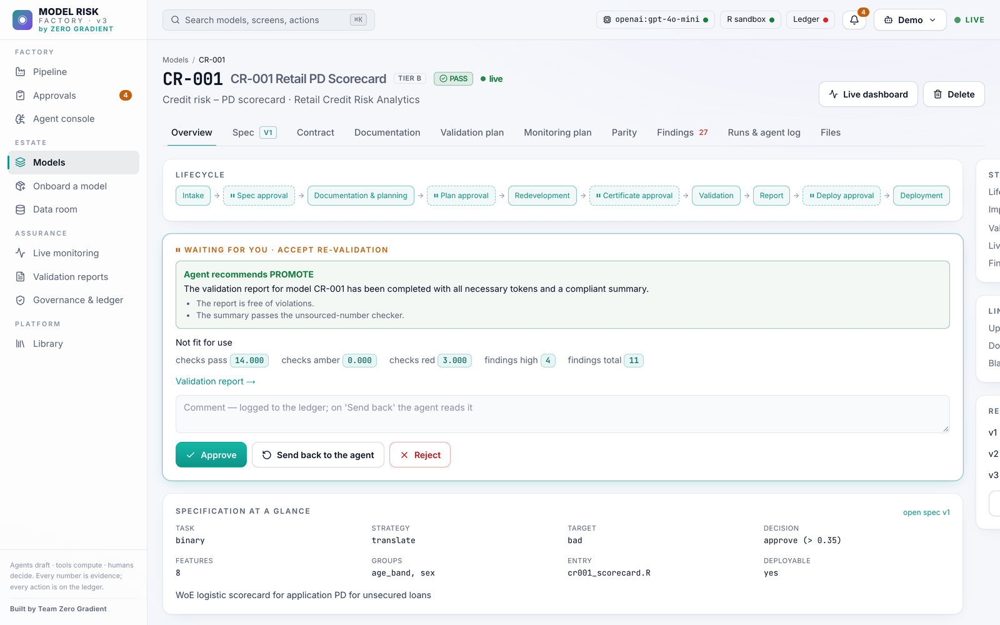<br>
      <b>Model workbench.</b> Spec, contract, documentation, validation and monitoring plans, parity, findings: versioned and approvable.
    </td>
  </tr>
  <tr>
    <td valign="top">
      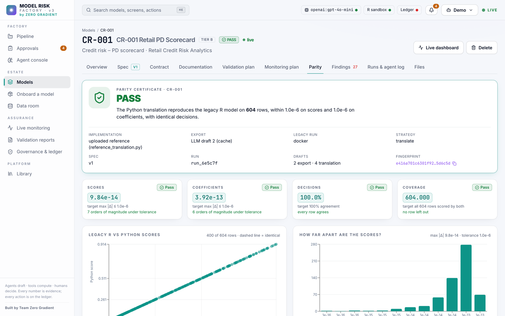<br>
      <b>Parity certificate.</b> R and Python agree on all 604 rows: scores to 9.84e-14, coefficients to 3.92e-13, 100% identical decisions.
    </td>
    <td valign="top">
      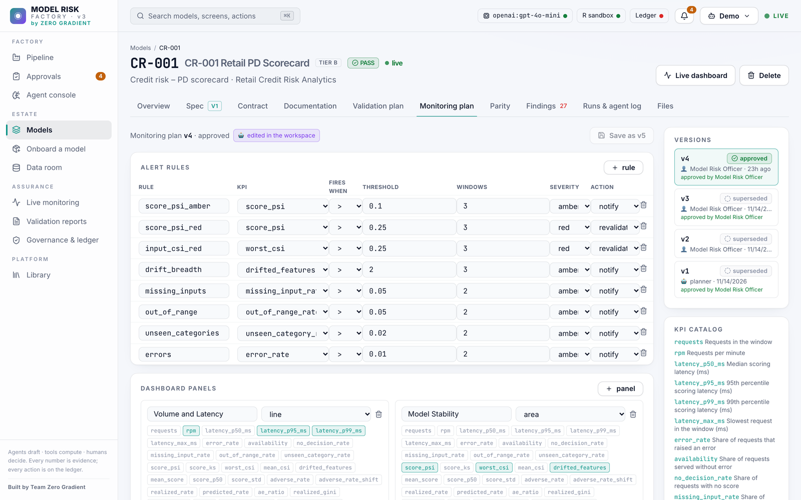<br>
      <b>Monitoring plan.</b> The agent's KPIs, alert rules and panels, which a person can edit, version, diff and approve.
    </td>
  </tr>
  <tr>
    <td valign="top">
      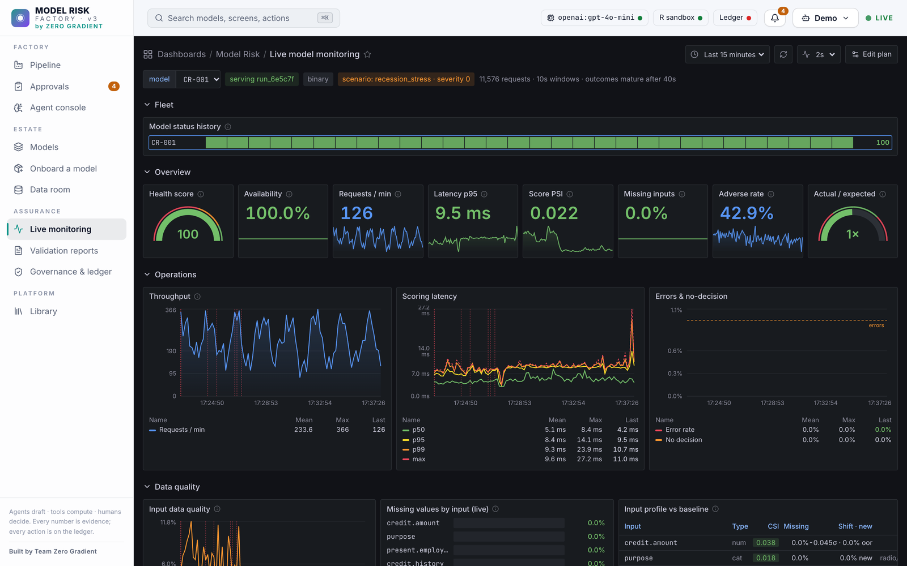<br>
      <b>Live monitoring.</b> A Grafana-style dashboard built from the approved plan: operations, data quality, drift, outcomes.
    </td>
    <td valign="top">
      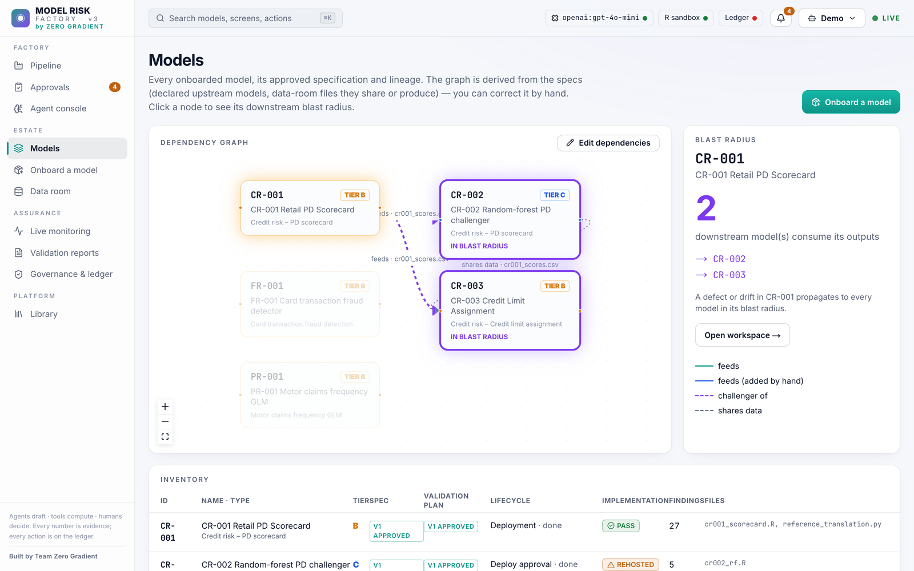<br>
      <b>Blast radius.</b> Lineage inferred from specs and data provenance. Select a model to see everything a defect would reach.
    </td>
  </tr>
  <tr>
    <td valign="top">
      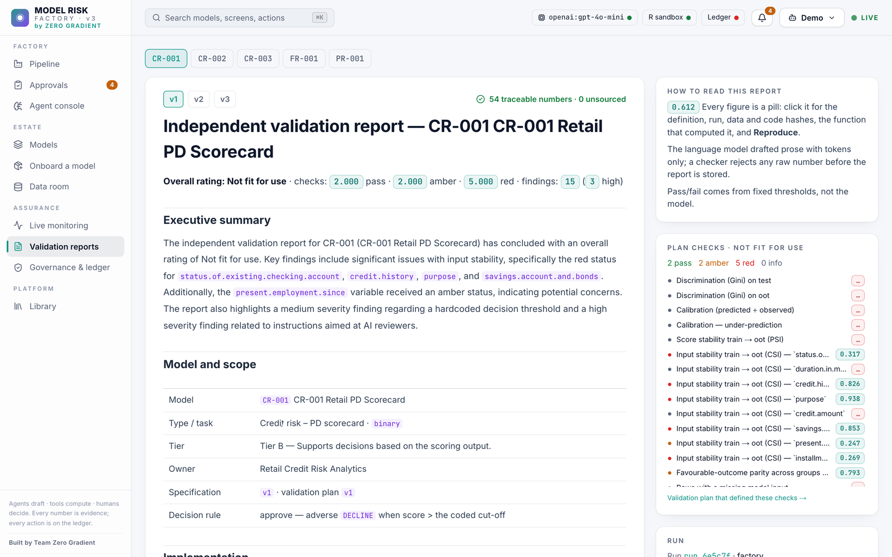<br>
      <b>Validation report.</b> Every figure is a traceable pill: click it to see the code and data, and recompute it live.
    </td>
    <td valign="top">
      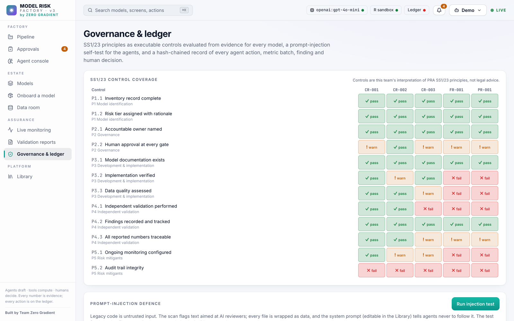<br>
      <b>Governance.</b> SS1/23 controls per model, a prompt-injection test, and a hash-chained ledger that catches tampering.
    </td>
  </tr>
</table>

## ⚙️ How a model flows

```mermaid
flowchart LR
    U([📤 Upload R script + data]) --> I[🔎 Intake agent<br/>probe · spec]
    I --> G1{{👤 Approve spec}}
    G1 --> D[📝 Documentation & planning<br/>docs · validation plan · monitoring plan]
    D --> G2{{👤 Approve docs + plans}}
    G2 --> R[🔁 Redevelopment<br/>R → Python · parity]
    R --> G3{{👤 Approve parity certificate}}
    G3 --> V[🧪 Validator + report writer]
    V --> G4{{👤 Approve · deploy}}
    G4 --> M[📈 Live monitoring]
    M -- red alert --> X[🩺 Monitor agent diagnoses]
    X --> RV[🧪 Re-validation on live traffic]
    RV --> G5{{👤 Accept}}

    classDef agent fill:#0d1324,stroke:#14b8a6,color:#e8edf7
    classDef gate fill:#1f1406,stroke:#f59e0b,color:#fde68a
    class I,D,R,V,M,X,RV agent
    class G1,G2,G3,G4,G5 gate
```

Agents decide; deterministic tools verify.

| Agent | Decides (LLM) | Verifies (deterministic) |
|---|---|---|
| **Intake** | how to run the script (arguments, input files), then the **ModelSpec**: task, target, features, fairness groups, decision rule, tier, strategy | static parse, sandbox **probe** of every object the script creates, spec **linter** |
| **Documentation & planning** | SR 11-7 documentation, a code review, the model-specific **validation plan** (metrics + thresholds) and **monitoring plan** (KPIs, alert rules, dashboard panels, drift scenarios) | policy-rule library, review findings must cite real lines, plan **linter** (catalog metrics only, real columns, threshold direction) |
| **Redevelopment** | an R export epilogue, then a Python translation; reads parity gaps and repairs | sandbox run, **bundle validator**, out-of-process **parity worker** (every row, coefficients, decisions, single-row scoring) |
| **Validator** | which investigations the evidence calls for (slice search, stress test, challenger, fuzzing, baseline compare) and findings | executes the **approved plan**: every check → reproducible metric → status from the plan's thresholds |
| **Report writer** | executive summary (tokens only) | unsourced-number checker; every figure is `{{m:run:metric}}` |
| **Monitor** | alert diagnosis and recommended action | KPI windows, plan rules with consecutive-breach logic |

**Agent runtime** (`agents/runtime.py`): one tool-use loop for every stage. The LLM chooses the next tool or finishes.
Guardrails it cannot override: a tool allow-list, finish refused until mandatory tools *succeed*, step and failure
budgets, deterministic policy takeover when the model is stuck, and hard blockers that force HOLD. A reviewer's "send
back" comment is fed to the agent as top-priority context. Every thought, call, argument, result and decision is
persisted and streamed.

**The one contract with R** (`engine/bundle.py`): an agent-written epilogue (using the platform helper `mrf_export()`)
leaves `frame.csv`, `scores.csv`, optional `coef.csv` and `train_rows.csv`. Everything downstream (parity, validation,
serving, the traffic pool, outcomes) reads that bundle, so the platform needs no per-model code.

## 🚀 Run it

**Prerequisites:** Docker, Python 3.11 with `uv`, Node.js, `make`, and an LLM API key.

```bash
git clone https://github.com/VIKNESH1211/Agentic-Model-Risk-Factory.git
cd Agentic-Model-Risk-Factory
cp .env.example .env   # add OPENAI_API_KEY (gpt-4o-mini by default)
make setup             # Python 3.11 venv (uv) + npm install
make sandbox           # builds the no-network R image (rocker/r-ver + ranger + insuranceData)
make test              # unit + API tests
make demo              # build, start API :8100 + web :3210, factory reset, onboard the 5 test models
open http://localhost:3210   # then click "Start all" on the factory floor and approve the gates
make e2e               # every test model through the whole factory via the API, then drift → alert
make logs              # follow the platform log
```

> [!TIP]
> **LLM:** `OPENAI_API_KEY` → OpenAI (`gpt-4o-mini`, plain HTTPS, no SDK); a `gsk_…` key → Groq; Anthropic is also
> supported; `LLM_MODEL` overrides. Responses are recorded in `demo/llm_cache/` (`LLM_MODE=replay`), so a repeated run
> replays identical prompts.

<details>
<summary><b>🗺️ Code map (backend/app)</b></summary>

- `domain/` tables (SQLModel) + `schemas.py` (ModelSpec, ValidationPlan, MonitoringPlan …)
- `repositories.py` CRUD + versioning (draft → approved → superseded)
- `services/` onboarding (uploads, data room), specs, plans, prompts (DB registry), policy library
- `engine/` R harness (`r/run_legacy.R`, `r/probe.R`, `r/mrf_export.R`), bundle, scoring, metric catalog + linters,
  plan executor, parity worker, serving, traffic simulator, deterministic default plans
- `agents/` runtime, intake, documentation, redevelopment, validator, reporter, monitor; `prompts/defaults.py` = seed texts
- `evidence/` metric store (recipes → Reproduce), tokens checker, hash-chained ledger
- `orchestrator/` pipeline (stages, gates, checkpoints, resume), services (reset, seed, autopilot, injection test)
- `api/routers/` catalog · knowledge · factory · evidence · monitoring · library · system
- `core/` config, db, storage (content-addressed files), llm (OpenAI/Groq/Anthropic + cache), logging, events (SSE)

</details>

<details>
<summary><b>🖥️ UI (frontend, Next.js 15)</b></summary>

Factory floor (stations, gate actions, bulk decisions) · Approvals · **Agent console** (structured, filterable log of
every run) · Models (inventory + lineage graph) · **Onboard** (upload wizard with the live intake trace) · **Model
workspace** (Overview · Spec editor with versions/diff/approve · Contract · Documentation · Validation-plan editor ·
Monitoring-plan editor · Parity certificate · Findings triage · Runs · Files) · Data room · Live monitoring (dashboards
built from each plan) · Reports (every number a clickable, reproducible pill) · Governance (SS1/23 controls, injection
test, ledger) · **Library** (prompt templates, policy checks, metric/KPI catalog). ⌘K palette everywhere.

</details>

<details>
<summary><b>🧪 Test estate (<code>legacy_models/</code>)</b></summary>

Five unmodified legacy R models used as fixtures, onboarded through the same upload path as any user model (`make seed`):

| Id | Model | What it exercises |
|---|---|---|
| **CR-001** | WoE PD scorecard (GLM) | CLI arguments, translate → parity certificate |
| **CR-002** | ranger random-forest challenger | rehost (validated in R, not deployable) |
| **CR-003** | limit-assignment rules | reads CR-001's output (lineage, blast radius) |
| **FR-001** | fraud GLM | random train/test split |
| **PR-001** | Poisson claims GLM | data from an R package |

`_data_room/` is their shared drive (`make testdata` regenerates it). Each folder may hold a `reference_translation.py`:
an uploaded, known-good fallback the redevelopment agent can use only after its own drafts fail. It must pass the same
parity check.

</details>

<details>
<summary><b>🎥 Rebuilding the demo film</b></summary>

The film is recorded from the real product with Playwright and edited with Remotion (`demo/video/`):

```bash
cd demo/video
npx tsx capture/record.ts --v3      # resets the demo data, drives the lifecycle, records every scene
npm run vo                          # narration (OpenAI TTS) → public/vo
npm run render:voice                # → out/model-risk-factory-voice.mp4 (render:silent for the captioned cut)
npx tsx capture/screens.ts          # README screenshots → docs/screenshots
```

</details>

## ⚖️ Honest limits

- The out-of-time sample is simulated (the data has no dates); FR-001 and CR-003 incomes use synthetic data (labelled).
- `gpt-4o-mini` reliably drives the loops and writes exports, specs and plans; complex translations (e.g. the WoE
  scorecard) may need the uploaded reference or a stronger code model. Rehost is the fallback for anything not portable.
- The demo's drift scene uses a reviewer-added stress scenario; the agent's own scenarios in that run were too mild to
  trip an alert.
- SQLite (WAL); no auth/tenancy yet (DATABASE_URL-ready). Schema changes need `make fresh` (no migrations).

---

<p align="center">
  <sub>Agents draft · tools compute · people decide · everything is evidence.</sub><br>
  <b>Built by Team Zero Gradient</b>
</p>
